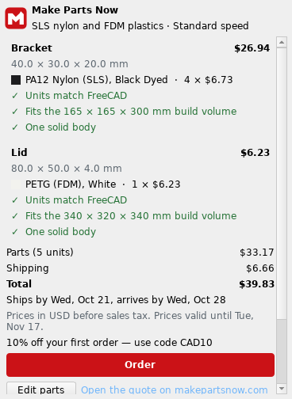
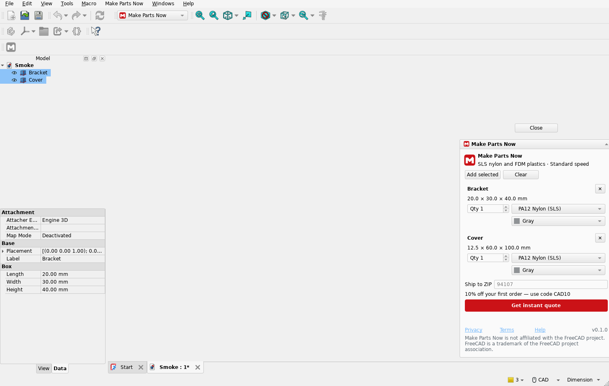

# Make Parts Now for FreeCAD: instant 3D printing quotes

A free FreeCAD workbench that prices 3D printing for the bodies you select, right inside FreeCAD. Choose SLS PA12
nylon or an FDM plastic (PLA, PETG, ABS, ASA, TPU, carbon-fiber nylon and PETG) for each part, see one delivered
price and the ship date in seconds, then order on [makepartsnow.com](https://makepartsnow.com). No account, no sign-in,
no order minimum. Parts are made in the US.



## Install

Requires FreeCAD 1.0 or newer (tested on FreeCAD 1.1 on Windows and Linux).

**Addon Manager (custom repository):** Edit > Preferences > Addon Manager > Custom repositories, add
`https://github.com/makepartsnow/makepartsnow-freecad` with branch `main`. Then open Tools > Addon Manager, find
**makepartsnow-freecad**, click Install and restart FreeCAD. Addon Manager updates and uninstalls it like any add-on.

**Or with git:** clone this repository into your FreeCAD `Mod` folder and restart FreeCAD. Update with `git pull`;
uninstall by deleting the folder.

| OS | Mod folder (FreeCAD 1.1) |
|---|---|
| Windows | `%APPDATA%\FreeCAD\v1-1\Mod` |
| Linux | `~/.local/share/FreeCAD/v1-1/Mod` |
| macOS | `~/Library/Application Support/FreeCAD/v1-1/Mod` |

```bash
git clone https://github.com/makepartsnow/makepartsnow-freecad.git
```

## How to get a quote

1. Select up to 25 PartDesign Bodies, Part features with one solid, or closed meshes, in the 3D view or the tree.
2. Switch to the **Make Parts Now** workbench and click **Quote with Make Parts Now**. The first time, read and accept
   what is sent (below).
3. Choose a quantity, material and finish or color for each part, enter the US ZIP code the parts ship to, and click
   **Get instant quote**. You see each part's price, printability checks (units match FreeCAD, fits the build volume,
   thin walls) and the delivery dates.
4. **Order** opens checkout on makepartsnow.com in your browser. You pay there through Stripe; the workbench never sees
   card details.



The workbench refuses, with the reason: assemblies and App::Part containers (select their bodies), links, compounds of
several solids, sketches and surfaces, hidden objects and meshes with holes.

## What leaves your computer

Nothing is sent until you accept the consent text (once) and click **Get instant quote**. Opening the panel only
fetches the current materials, limits and any promotion code.

For a quote it sends, to makepartsnow.com only: one STEP file per selected part (STL in mm for a mesh, or if STEP
export fails and you agree), with the author, organization and file path removed from the STEP header; the quantity,
material and finish you chose; and the ZIP code. It never sends the `.FCStd` document or anything else in it. Anonymous
usage counts are sent only if you tick that box. Details: [PRIVACY.md](PRIVACY.md).

Delete your uploaded files at any time with **Delete my uploaded files** in the panel.

## Support

Email nathan@makepartsnow.com. Security issues: [SECURITY.md](SECURITY.md). Changes: [CHANGELOG.md](CHANGELOG.md).

## License

MIT ([LICENSE](LICENSE)). The `core/` folder is the [Make Parts Now CAD core](https://github.com/makepartsnow/makepartsnow-cad-core),
our own MIT code shared with our Autodesk Fusion add-in, pinned by `core/CORE_PIN.json`.

Make Parts Now is not affiliated with the FreeCAD project. FreeCAD is a trademark of the FreeCAD project association.
